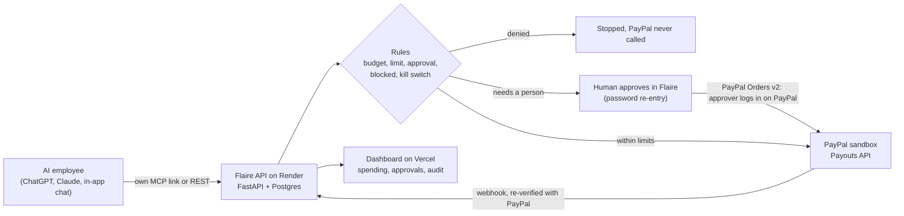

# Flaire for PayPal

**The finance department for AI employees, paying through PayPal.** Built for the PayPal AI Hackathon. Sandbox only: no real money moves.

An AI employee (ChatGPT, Claude or Gemini) asks to buy something. Flaire checks the budget, per-purchase limit, allowed categories, blocked suppliers and approval rules first. A purchase under the limit goes straight through, a larger one waits for a human to approve, and a blocked one is stopped. Only an approved purchase reaches PayPal, where Flaire sends the money with the **PayPal Payouts API** in the PayPal sandbox.

```
AI employee
  -> Flaire (limits, approvals, audit)
  -> approved only -> PayPal Payouts API (sandbox)
  -> merchant
```

**How PayPal is used** (`app/integrations/payments/paypal.py`)
- OAuth client-credentials token from `/v1/oauth2/token`
- `POST /v1/payments/payouts` for every approved purchase, with a unique `sender_batch_id` so a retry can never pay twice
- PayPal has no SAR, so amounts convert to USD at 3.75 and the rate and USD amount are saved on each transaction
- Flaire's own checks run first: a denied or waiting request never calls PayPal (see `tests/test_paypal.py`)

**How AI is used:** the AI employee requests purchases through an MCP connector (ChatGPT and Claude) and a REST API. A Gemini assistant, limited to Flaire topics, answers questions on the website and inside the dashboard and can act on approvals.

**What is new for this hackathon** (Flaire existed before it; this is the significant update)
- A PayPal rail: approved purchases are paid out with the PayPal Payouts API (`app/integrations/payments/paypal.py`)
- Payment lifecycle: a payout starts as "authorized" and becomes "settled" when PayPal says SUCCESS. If PayPal fails, returns or blocks it, the transaction is reversed and the budget and card balance are given back (`app/paypal_sync.py`)
- PayPal Checkout (Orders v2) approval: with `PAYPAL_CHECKOUT_APPROVAL=true`, a purchase that a person approves in Flaire is paid through a PayPal order. The approver is sent to PayPal, confirms with their own PayPal login, and Flaire captures it on return (`/paypal/return`). Nothing is paid until PayPal confirms
- A webhook receiver for PayPal payout events (`POST /api/v1/webhooks/paypal`). It never trusts the body: the payout state is always read from PayPal's API first, and signatures are verified when `PAYPAL_WEBHOOK_ID` is set
- A "Test PayPal connection" button (Connections page) that proves the sandbox keys work without moving money
- A PayPal panel on every paid transaction in Activity, with the USD amount and exchange rate
- 10 PayPal tests (`tests/test_paypal.py`), 113 tests in total

**Set up the PayPal sandbox (about 10 minutes)**
1. Sign in at https://developer.paypal.com, open Apps & Credentials, make sure **Sandbox** is selected, and create an app. Under Features, tick **Payouts**.
2. Under Testing tools, Sandbox accounts, open (or create) a **Personal** account and copy its email. It stands in for the merchant who gets paid.
3. Set `PAYPAL_CLIENT_ID`, `PAYPAL_CLIENT_SECRET` and `PAYPAL_RECEIVER_EMAIL` (in Render, or `.env` locally). Never commit them.
4. Optional: set `PAYPAL_CHECKOUT_APPROVAL=true` and `FRONTEND_URL` (your web app address) so human-approved purchases are confirmed in PayPal. The approver pays from a sandbox Personal (buyer) account.
5. Optional: in the app's Webhooks section, add `https://YOUR-API/api/v1/webhooks/paypal` for the events `PAYMENT.PAYOUTSBATCH.SUCCESS`, `PAYMENT.PAYOUTSBATCH.DENIED` and `PAYMENT.PAYOUTS-ITEM.FAILED`, then set `PAYPAL_WEBHOOK_ID`. Without it, Flaire still checks PayPal whenever the dashboard loads.
6. In Flaire open Connections and press **Test PayPal connection**. It should say "Connected to the PayPal sandbox".
7. Add an AI employee. Its card shows "PayPal Sandbox". Ask for a purchase, then open https://www.sandbox.paypal.com with the Personal account to see the money arrive.

**For judges:** open the live demo and follow `docs/JUDGES.md` (test login, a two minute walkthrough). Everything is free and sandbox only. Amounts are stored in SAR and shown in US dollars on the PayPal edition.

Live demo: https://flaire-paypal.vercel.app (use "Try free"). API: https://flaire-api-cmrs.onrender.com (free tier, the first request after a quiet period can take about a minute). Code is MIT licensed.

---

## Architecture



## Run it locally

Needs Python 3.11+ and Node 20+.

```bash
# Backend (from the repo root)
python -m venv .venv && source .venv/bin/activate      # Windows: .venv\Scripts\activate
pip install -r requirements.txt
cp .env.example .env                                   # add the PayPal sandbox values from the steps above
python seed.py                                         # demo company, AI employees and a card
uvicorn app.main:app --reload --port 8000              # API docs at http://localhost:8000/docs

# Frontend (second terminal)
cd frontend && cp .env.example .env && npm install && npm run dev      # http://localhost:5173
```

Local login after seeding: `demo@flaire.sa` / `demo1234`. Run the tests with `python -m pytest -q` (113 tests: every spending rule, bypass attempts, the PayPal flows with PayPal mocked, and the audit chain).

## How an AI employee connects

Each AI employee gets its own link, `https://<api>/api/v1/mcp/<agent_key>`. Add it as a custom connector in ChatGPT or Claude. The employee's identity comes from the link, so the AI cannot choose who it is or raise its own limits. It has tools to check its budget, request a purchase and read a request's status. There is no approve tool: only a person approves, in Flaire. There is also a REST route, `POST /api/v1/agent/purchase-requests`, and a built in "Talk to" chat for each employee.

## The rules Flaire enforces before PayPal is called

Monthly budget per employee and per company, a per purchase limit, a human approval threshold, trusted merchants, blocked categories, a split purchase check, duplicate protection, and a kill switch that freezes every AI employee at once. Every event goes into a hash chained audit log (`GET /api/v1/audit/verify` detects tampering). Details: `docs/SECURITY.md` and `docs/THREAT_MODEL.md`.

## Project layout

```
app/         FastAPI backend
  services.py                      the purchase pipeline
  integrations/payments/paypal.py  the PayPal adapter
tests/       pytest suite
frontend/    React + Vite + Tailwind app and site
             (VITE_PAYPAL_ONLY=true builds the PayPal edition)
docs/        API, security, judges guide, demo script
render.yaml  Render blueprint for the API and Postgres
```

## Deploy

- **API on Render:** New, Blueprint, this repo. Add the PayPal and Gemini values as environment variables.
- **Dashboard on Vercel:** root directory `frontend`, env `VITE_API_URL=https://<your-api>/api/v1` and `VITE_PAYPAL_ONLY=true`.

## Honest limits

Everything runs in the PayPal sandbox. No real money moves. Every payout goes to one sandbox merchant account, so the supplier name on a request is recorded but is not a real supplier, no real company credentials are used by any AI, and live PayPal accounts are the next step.
